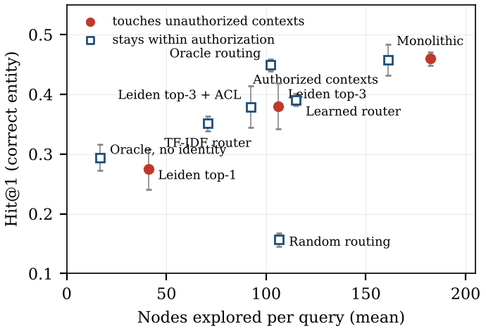

# Governed Knowledge-Graph Retrieval

**Bounded contexts or graph communities? Partitioning enterprise knowledge graphs for governed retrieval**

Graph retrievers usually scope retrieval by graph topology, for example with community detection. Enterprises scope data by ownership and access rights. This repository contains a benchmark and a shared retriever for measuring what retrieval gains or loses when its scope follows organizational boundaries (bounded contexts) and the requester's authorization instead of graph communities.

The accompanying paper is under review.



## What is in the benchmark

- **Graphs where the two kinds of boundary disagree.** A synthetic bank with five bounded contexts (Customer, Payments, Lending, Risk, Support) and a shared identity kernel of party nodes. Parties are grouped into households, so Leiden communities reach a modularity of 0.74 yet each one spans 4.9 of the 5 contexts on average.
- **Correct-entity targets.** Every query names one target node; a query is solved only if that exact node is retrieved.
- **Roles and authorization.** Every query carries one of five roles, each authorized for three or four contexts.
- **Paraphrases and shared vocabulary.** Seven query templates in three paraphrase forms, with words such as *account*, *payment* and *limit* used across contexts. The learned router never sees the third form during training.
- **Restricted requests.** 300 extra requests per instance that the role may not answer, either because the answer lies in an unauthorized context or because finding it needs unauthorized evidence.
- **Three sizes, five seeds.** 500, 2,000 and 8,000 parties (about 8k, 32k and 125k nodes).

## Scopes compared

| Scope | What it searches |
|---|---|
| Monolithic | The whole graph |
| Post-filter | The whole graph, then unauthorized results are removed from the ranking |
| Authorized contexts | Every context the role may see, plus the identity kernel |
| Oracle routing | Only the contexts the query needs (upper bound for any router) |
| TF-IDF router / Learned router / Random routing | Contexts chosen by a router, within the role's authorization |
| Leiden top-1 / top-3 | The best-matching graph communities (GraphRAG-style scoping without LLM summaries) |
| Leiden top-3 + ACL | Leiden top-3 intersected with the role's authorization |
| No-identity ablations | The same scopes without the identity kernel |

## Headline results (8,000 parties, five seeds)

| Scope | Hit@1 | Nodes reached | Queries touching unauthorized data |
|---|---|---|---|
| Monolithic | 0.460 | 182 | 100% |
| Authorized contexts | 0.457 | 161 | 0% |
| Oracle routing | 0.449 | 102 | 0% |
| Learned router | 0.391 | 115 | 0% |
| Leiden top-3 | 0.380 | 106 | 100% |

Restricting retrieval to authorized contexts left accuracy unchanged (paired difference −0.002, 95% CI [−0.016, 0.010]). Filtering after retrieval let unauthorized evidence raise disclosure on restricted requests by 9 to 37 points across sizes; scoping before retrieval did not. All numbers are in `summary.json`.

## Files

| File | Purpose |
|---|---|
| `generator.py` | Graph, query and restricted-request generator |
| `evaluate.py` | Runs every scope for one (size, seed) and writes per-query results to `results/` |
| `aggregate.py` | Means with 95% t-intervals over seeds and paired bootstrap tests; writes `summary.json` |
| `figures.py` | Draws the figures in `figures/` from `summary.json` |
| `summarize_one.py` | Quick summary of a single results file |
| `results/` | Per-query results for 3 sizes × 5 seeds |

## Reproduce

Python 3.11 or later. About three minutes on two CPUs.

```bash
pip install -r requirements.txt
for p in 500 2000 8000; do for s in 1 2 3 4 5; do python evaluate.py --parties $p --seed $s; done; done
python aggregate.py
python figures.py
```

Results are deterministic for a given seed.

## License

MIT. See `LICENSE`.
